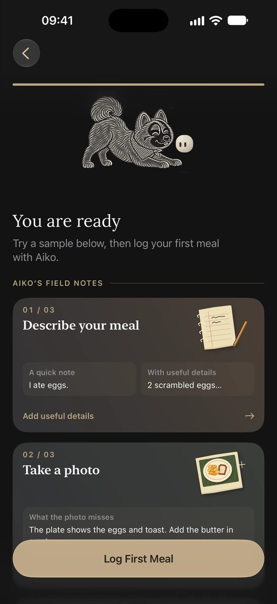
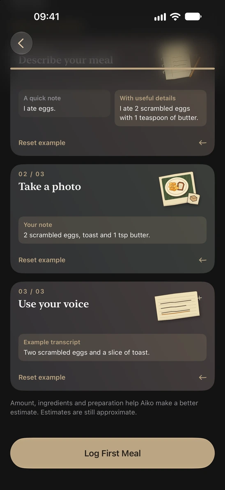

Sou estudante de Ciência da Computação na **PUC Minas**, em Belo Horizonte. Trabalho com sustentação e evolução de sistemas de manufatura (MES/AMS) e desenvolvo aplicativos para iOS.

  
  
  
  
  

## Projetos em destaque

### 📱 Aiko

Diário nutricional para iPhone, feito com SwiftUI, React Native e Expo. Dá para registrar refeições, ajustar porções e acompanhar o consumo ao longo do dia.

  
  

*Capturas do onboarding no simulador de iPhone, com exemplos de registro por texto, foto e voz.*

### 🔬 TCC · Predição de atrasos logísticos

Investigo quais informações disponíveis no checkout ajudam a estimar o risco de atraso. Comparo Random Forest e XGBoost com referências simples de frequência e avalio os modelos em janelas cronológicas.

### 🌐 Registro Alimentar Inteligente

Protótipo web em React e Expo que demonstra o fluxo de registro de refeições, da revisão das porções ao resumo do dia. [Ver código](https://github.com/pedrohenrimoreira/registro-alimentar-prototipo)

### 🧩 K-Centers em grafos

Comparação em Java entre uma heurística e busca exaustiva para escolher os centros de um grafo. [Ver implementação](https://github.com/pedrohenrimoreira/Graphs-TP02)
